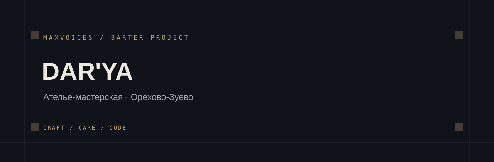
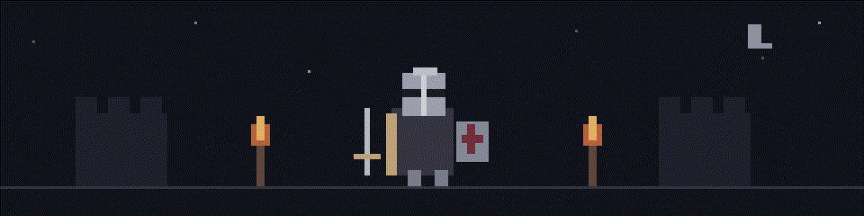
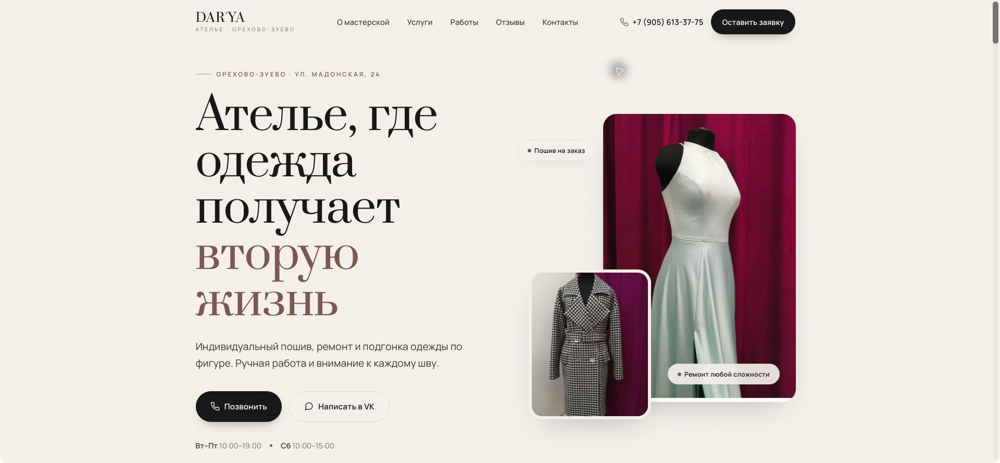

<p align="center"></p>
<p align="center"></p>
<p align="center"><sub>Из мастерской Максима Голосова · MaxVoices</sub></p>

# DAR'YA · Ателье-мастерская

Сайт ателье в Орехово-Зуево: услуги пошива и ремонта, примеры изделий, отзывы и понятный путь к обращению в мастерскую. Клиентский проект, выполненный **по бартеру**.

| Контекст | Детали |
| :--- | :--- |
| Формат | Клиентский сайт, бартер |
| Разработка | Максим Голосов, с помощью ИИ |
| Дизайн | Создавался сразу при вёрстке, без отдельного макета Figma |
| Технологии | HTML, CSS, JavaScript |

## Интерфейс



## Что сделано

- Последовательный лендинг: знакомство с мастерской, услуги, работы, процесс, отзывы и контакты.
- Спокойная визуальная подача с акцентом на ремесло и детали одежды.
- Навигация по разделам и ссылки для связи с ателье.
- Изображения встроены в HTML: портфолио-версия хранится в одном файле.

## Посмотреть устройство проекта

```text
index.html        Разметка, стили, логика и встроенные изображения
 docs/assets/     Оформление портфолио
```

Бизнес-контакты в интерфейсе относятся к мастерской. Формы и способы связи следует проверять перед использованием как действующего сайта.

## Запустить локально

Нужен Python 3. Из корня проекта:

```bash
python3 -m http.server 8080 --bind 127.0.0.1
```

Откройте **http://127.0.0.1:8080**. Остановка сервера: `Ctrl+C`.

## Разместить сайт

Это статический сайт. Для Vercel импортируйте репозиторий, выберите **Other**, оставьте команду сборки пустой и используйте корневую папку как Output Directory. Секреты и переменные окружения для этой версии не требуются.

Ссылка на развёрнутое демо будет добавлена после публикации и проверки. Адрес заказчика здесь не выдаётся за адрес этой портфолио-версии.

## Автор

**Максим Голосов / MaxVoices** · [GitHub](https://github.com/MaxVoicesDeveloper) · [Связаться](https://t.me/MaxVoicesDeveloper)

<sub>Клиентские названия, логотипы, фотографии и другие материалы принадлежат соответствующим правообладателям. Публикация в портфолио не предоставляет право использовать их в других коммерческих проектах.</sub>
